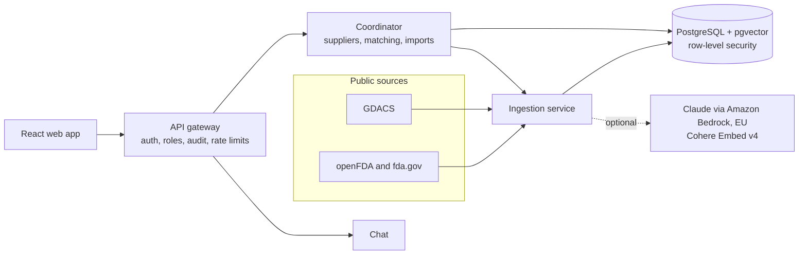

# SCIRM — Supply Chain Risk Monitoring

[](https://github.com/DevilsDev/SCIRM_Monorepo/actions/workflows/ci.yml)
[](https://github.com/DevilsDev/SCIRM_Monorepo/actions/workflows/docs.yml)
[](LICENSE)


SCIRM watches a company's suppliers against public regulatory and disaster records and
tells procurement and quality teams, with a source for every statement, when something
concerns one of them. It is built first for pharmaceutical and healthcare supply chains.

> **Status: beta (Phase 1).** The core flows below are working and tested. Pages that
> still run on built-in sample data (scenario simulator, "Alternatives", Predictions,
> Components) are hidden outside development; see [Project status](#project-status).

---

## Contents

- [What it does](#what-it-does)
- [How it works](#how-it-works)
- [Evidence and evaluation](#evidence-and-evaluation)
- [Quick start](#quick-start)
- [Configuration](#configuration)
- [Testing](#testing)
- [Security and tenancy](#security-and-tenancy)
- [Repository layout](#repository-layout)
- [Deployment](#deployment)
- [Documentation](#documentation)
- [Project status](#project-status)
- [Contributing](#contributing)
- [License](#license)

---

## What it does

| Capability | Description |
|---|---|
| **Public-record monitoring** | Ingests five public sources: FDA drug recalls, FDA warning letters, the FDA import-alert Red Lists, FDA drug shortages, and GDACS disaster alerts. Each record keeps its public date separately from the event date. |
| **Supplier matching** | Links records to your suppliers by name, known aliases and parent company, and says how each match was made. Similar-name matches are marked for checking. Disasters are *exposure*, never incidents: matched by distance to the supplier's sites (from SAP addresses or added by hand), or by country when no site is known. See [Disaster exposure by site](docs/site-exposure.md). |
| **One event, one row** | An FDA recall event often has a recall number for every strength or pack. SCIRM groups them, so one event counts once and lists the products it covers. |
| **Watch flag** | A back-tested recall-history rule marks suppliers worth a closer look. It is a prompt to investigate, not a prediction (see [evaluation](#evidence-and-evaluation)). |
| **Cited answers** | Ask a question about a supplier ("Any sterility problems?"). Every sentence in the answer cites the record it comes from, and a deterministic checker removes any sentence its records do not support. |
| **SAP supplier import** | Upload an export of the SAP vendor master (table LFA1). You see what will change before anything is saved. SCIRM does not connect to SAP and stores no SAP credentials. See [the guide](docs/sap-import.md). |
| **Spend ranking** | Upload purchase-order items (EKKO/EKPO or an ME2N list) to rank suppliers by 12-month spend, per currency and never converted. |
| **Supplier scan** | Upload a supplier list (CSV) and get a self-contained, cited report. The list is not stored. |
| **Teams** | Invitations, four roles (admin, analyst, viewer, auditor), MFA, and an append-only audit log. |
| **Pilot metrics** | Users rate matched records and answers. Admins see the share of records rated useful, the wrong-supplier rate, the share of answers rated helpful, and citation accuracy. |

SCIRM never shows a rating nobody made. A supplier's risk score appears only after an
assessment has recorded one; until then it reads *Not assessed*.

## How it works



- **Ingestion** (`services/ingestion`) fetches the public sources on a schedule. Current
  lists (shortages, import alerts) are compared with the previous fetch, and entries that
  disappeared are marked delisted. It also matches records to suppliers and runs the
  Evidence Engine.
- **Coordinator** (`services/coordinator`) owns suppliers, the SAP import, and the
  multi-agent assessment pipeline (planner, researcher, executor and reviewer services).
- **API gateway** (`apps/api-gateway`) is the only public entry point. It handles sign-in,
  MFA, invitations, role checks, rate limiting and the audit log, and passes each tenant's
  identity to the internal services.
- **Evidence Engine** (`libs/evidence`) combines keyword retrieval with optional vector
  search, writes answers either from the records' own fields or with an LLM, and checks
  every cited sentence.
- **AI is optional.** Without a model configured, answers are composed directly from the
  records. With Bedrock configured, requests stay in the EU and never fall back to other
  regions. See [Bedrock setup](docs/bedrock-setup.md).

**Stack:** Python 3.11, FastAPI, SQLAlchemy (asyncpg), Alembic, PostgreSQL 16 with
pgvector, React 18, TypeScript, Vite, Tailwind CSS, Docker, Kubernetes, Prometheus and
Grafana.

## Evidence and evaluation

Every change to scoring or retrieval is measured against fixed evaluations that use real
public data.

**Back-test** ([`evals/backtest`](evals/backtest/README.md)): would the Watch flag have
flagged a firm before its next serious (Class I) FDA recall?
- The threshold was set on 2022 data and frozen; results are from 2023 on.
- The score at any date uses only records published before that date.
- Result: of 71 Class I recall events at firms with FDA history, **41% were flagged at
  least 30 days ahead**.
- Firms with no FDA history cannot be scored, and are reported separately.

**Evidence Engine** ([`evals/evidence`](evals/evidence/README.md)):
- **Retrieval**, on a held-out question set never used for tuning: recall@10 0.82, MRR
  0.94, and 83% of the distinct relevant events in the top 10 (a recall covering many
  products counts once).
- **Citation checker:** it rejects none of 400 correct sentences, and it catches 99.8% of
  deliberately corrupted ones (wrong dates, firms, classes or numbers, negations,
  invented counts).

These are synthetic, public-data evaluations, not results from customers.

## Quick start

**Prerequisites:** Docker with Compose v2, Git. For work outside containers: Python 3.11
and Node.js 22.

```bash
git clone https://github.com/DevilsDev/SCIRM_Monorepo.git
cd SCIRM_Monorepo
cp .env.example .env        # optional for local development; see Configuration
docker compose -f docker-compose.dev.yml up --build
```

| Service | URL |
|---|---|
| Web app | http://localhost:3000 |
| API gateway (OpenAPI docs at `/docs`) | http://localhost:8000 |
| Grafana | http://localhost:3001 |
| Prometheus | http://localhost:9090 |

All published ports are bound to `127.0.0.1`. The internal services are reachable only
inside the Compose network; `docker-compose.debug-ports.yml` publishes them when you
need to debug one.

On first start the `migrate` job creates the schema and the restricted application
role, and seeds three demo organisations. Ingestion then fetches the public sources, which
takes under a minute.

**Demo sign-in (development only):**

| Account | Organisation | Role |
|---|---|---|
| `sarah.chen@pharmacorp.com` | PharmaCorp International | admin |
| `marcus.rodriguez@pharmacorp.com` | PharmaCorp International | analyst |
| `lisa.park@medtech.com` | MedTech Solutions | admin |
| `auditor@scirm.dev` | SCIRM Audit | auditor |

The password is `DEV_PASSWORD` from your `.env`. If that is not set, the gateway
generates one at start-up and prints it in its log
(`docker compose -f docker-compose.dev.yml logs api-gateway`). Demo suppliers are marked
*Demo*. Those named after real companies show real public records, but the supplier
relationships are fictional.

**Common tasks** (`make help` lists everything):

```bash
make dev              # start the full stack
make test             # backend and frontend tests, as CI runs them
make docs-serve       # documentation at http://localhost:8001
make db-migrate       # run migrations and seed the demo tenants
make health           # gateway health and container status
```

## Configuration

Settings come from environment variables. `.env.example` documents all of them. The
most important:

| Variable | Purpose |
|---|---|
| `ENVIRONMENT` | `development`, `test`, `staging` or `production`. Outside development the services refuse to start without the secrets below. |
| `JWT_SECRET_KEY` | Token signing key; at least 32 random characters outside development. |
| `SERVICE_API_KEY` | Shared key for gateway-to-service calls; required outside development. |
| `DATABASE_URL`, `STORE_BACKEND` | PostgreSQL connection; `STORE_BACKEND=postgres` (or `memory` for tests). |
| `PUBLIC_APP_URL` | Base URL used in invitation links. |
| `SIGNUP_MODE` | `open` in development, `closed` elsewhere (people join by invitation). |
| `MFA_ENABLED` | Enables TOTP multi-factor sign-in. |
| `MFA_ENCRYPTION_KEY` | Encrypts MFA seeds at rest (AES-256-GCM, bound to the user). Required outside development; `MFA_ENCRYPTION_KEY_PREVIOUS` supports rotation. |
| `SAMPLE_FEATURES` | Shows the sample-data pages and allows their API endpoints. Defaults to on in development and test, off elsewhere; keep it off for pilots. |
| `LLM_PROVIDER`, `BEDROCK_REGION`, `BEDROCK_MODEL_ID`, `EMBEDDINGS_PROVIDER` | Optional AI. EU-only by default (`LLM_EU_ONLY=true`). |
| `OPENFDA_API_KEY` | Optional; raises openFDA rate limits. |

Never commit `.env` or put secrets in code. In Kubernetes they come from Secrets, and
Bedrock access uses an IAM role (IRSA), not access keys.

## Testing

```bash
pip install -r requirements-test.txt
make test-backend                          # in-memory store
STORE_BACKEND=postgres TEST_POSTGRES_URL=postgresql://... make test-backend
cd apps/frontend && npm ci && npm test     # frontend unit tests
python evals/backtest/backtest.py          # back-test report
python evals/evidence/run_eval.py          # Evidence Engine evaluation
```

The backend suite covers authentication and MFA, tenant isolation (including raw-SQL
row-level-security tests on PostgreSQL), invitations, feedback, the SAP import,
matching, the source parsers, and the Evidence Engine. It also checks that the product
never presents sample or placeholder data as real.

CI runs, on every pull request:
- the backend suite on both store backends
- the frontend type check, tests and build
- a hardened build of every service image
- Kubernetes manifest validation
- a strict documentation build

## Security and tenancy

- **Tenant isolation:**
  - Tenant data is protected by PostgreSQL row-level security. On data tables it is
    forced, so even the table owner is filtered. On users and invitations it is enabled
    but not forced, so the narrow sign-in and invitation lookup functions can work
    before a tenant is known.
  - The application connects as a role without superuser or bypass rights.
  - Tests check isolation with raw SQL.
- **Authentication:**
  - Access tokens last 60 minutes and refresh tokens 30 days.
  - Passwords are hashed with bcrypt, and TOTP MFA is supported. MFA seeds are encrypted
    at rest with AES-256-GCM.
  - Invitation tokens are stored hashed, used once, and travel in the URL fragment,
    never in a path or query string.
- **Authorisation:**
  - Four roles. Only admins manage the team; only admins and analysts change data.
  - An organisation always keeps at least one active admin.
- **Audit:** every state-changing call is recorded in an append-only log. File contents
  and question text are not stored.
- **Services:**
  - Internal services are not published.
  - They require the shared service key outside development.
  - They run as non-root, with read-only filesystems and no Linux capabilities.

Report security issues privately to the maintainers. Do not open a public issue.

## Repository layout

```
apps/
  api-gateway/       Public API: auth, roles, audit, routing
  frontend/          React + TypeScript web app
services/
  coordinator/       Suppliers, matching, SAP import, assessment pipeline
  ingestion/         Public-source ingestion, matching, Evidence Engine API, supplier scan
  chat/              Chat assistant
  planner/ researcher/ executor/ reviewer/   Assessment agents
  risk-scorer/ discovery/ procurement/ simulator/ component-tracker/
libs/
  common/            Store (PostgreSQL and in-memory), auth, tenancy, LLM clients
  intel/             Source connectors, name matching, Watch scoring, supplier scan
  evidence/          Retrieval, answer composer, citation checker, embeddings
  integrations/      ERP connectors, SAP LFA1 import
alembic/             Database migrations
evals/               Back-test and Evidence Engine evaluations
docs/                Guides, runbooks and architecture decisions (MkDocs)
infra/               Kubernetes manifests (staging), nginx
scripts/             Database setup, tenant creation, supplier scan, OpenAPI export
tests/               Backend test suites
```

## Deployment

- **Images:** every backend service builds from one hardened image
  (`docker/service.Dockerfile`). The frontend is served by unprivileged nginx.
- **Staging:**
  - Kubernetes manifests are in `infra/k8s/staging`, and migrations run as a Job.
  - `.github/workflows/deploy.yml` applies the manifests and waits for every workload.
  - See the [deployment runbook](docs/operations/runbooks/deployment-runbook.md).
- **Before a real deployment:** set `PUBLIC_APP_URL` and the Bedrock IAM role in the
  staging manifests, and store every secret in Kubernetes Secrets.

## Documentation

The `docs/` folder is built with MkDocs (`make docs`, or `make docs-serve` to browse
locally). It covers:
- [Importing suppliers from SAP](docs/sap-import.md)
- [Bedrock (EU) setup](docs/bedrock-setup.md)
- [Deployment runbook](docs/operations/runbooks/deployment-runbook.md)
- [Branching model](docs/development/branching.md)
- Architecture decision records in `docs/architecture/adr/`

The Documentation workflow attaches the built site and every service's OpenAPI spec to
each run. Publishing to GitHub Pages is off: ADR-003 calls for organisation-only Pages,
and the workflow file explains how to enable publishing.

## Project status

**Working and tested:**
- public-record ingestion and supplier matching
- the Watch flag
- cited answers
- SAP supplier import and supplier scan
- teams, roles, MFA and audit
- feedback and pilot metrics

**Not yet production-grade:**
- **Sample data:** the scenario simulator, "Alternatives" suggestions, Predictions and
  Components use built-in sample data. They are hidden, and their endpoints refused,
  unless `SAMPLE_FEATURES` is on (the development default). When shown, they carry a
  "Sample data" banner.
- **Risk scores:** no supplier risk assessment is recorded yet, so scores read
  *Not assessed*.
- **Not yet built:**
  - direct SAP API connection
- **Untested in this repository:** live Bedrock calls; they need EU AWS access.

## Contributing

1. Branch from `develop` (`feat/...`, `fix/...`, `ci/...`). See the
   [branching model](docs/development/branching.md).
2. Keep changes covered by tests. Changes to scoring or retrieval must report the
   back-test and Evidence Engine results, and must not be tuned on the held-out
   evaluation sets.
3. Open a pull request against `develop`. CI must pass before merging. `main` is updated
   from `develop` for releases.

## License

[MIT](LICENSE) © 2025 Dev Devil

The city gazetteer in `libs/intel/data/cities.tsv.gz` is derived from
[GeoNames](https://www.geonames.org) and licensed CC BY 4.0. Public records come from the
U.S. FDA (openFDA and fda.gov) and [GDACS](https://www.gdacs.org).
